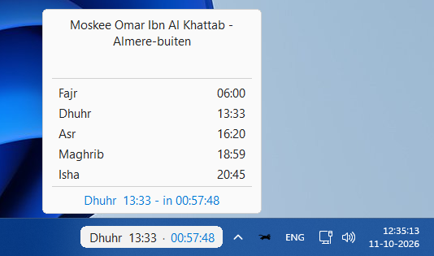
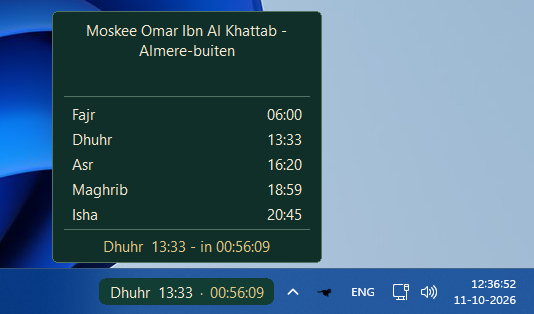
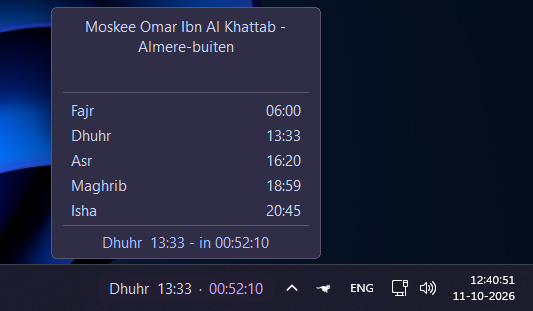
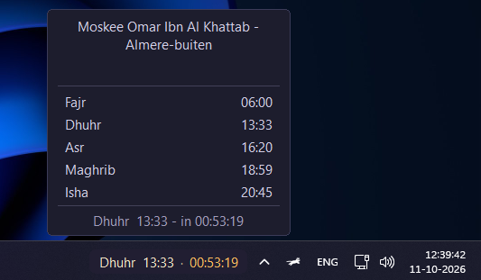

# Mawaqit Prayer Clock

An unofficial, customizable **Mawaqit prayer clock for the Windows 11 taskbar**, built as a [Windhawk](https://windhawk.net/) mod.

Displays the upcoming prayer and a live countdown in a taskbar pill, with a clickable prayer-schedule popup. Designed with the **Emberveil** visual style in mind.

> **Release candidate: v0.6.2.** Tested by the project author in their Windows setup; broader compatibility has not yet been established.

## Features

- Upcoming prayer name, scheduled time, and live countdown
- Clickable prayer-schedule popup
- Five appearance themes: **Emberveil**, **Windows / System**, **Traditional Islamic**, **Catppucchin Mocha**, and **Custom**
- Independent custom colors for the pill and popup
- Visibility switches for the prayer label, countdown, and popup
- Adjustable widget dimensions, positioning, tray gap, and corner radius
- Background schedule updates through native WinHTTP, with configurable refresh interval
- Live settings updates without restarting Explorer

## Screenshots

Mawaqit Prayer Clock supports multiple appearance themes to match your Windows 11 desktop.

Windows System Default | Traditional Islamic |
|:---:|:---:|
 |  |

| Catppucchin Mocha | Emberveil |
|:---:|:---:|
|  |  |

Desktop Integration

See how Mawaqit Prayer Clock integrates into a fully customized Windows 11 desktop.

## Requirements

- Windows 11
- [Windhawk](https://windhawk.net/)
- Internet access to `mawaqit.net` for schedule updates
- A mosque page available on Mawaqit

The mod targets the 64-bit Windows Explorer process (`explorer.exe`). Other configurations have not been validated.

## Installation

1. Install and launch Windhawk.
2. Create a new mod in Windhawk's mod editor.
3. Copy the contents of [`src/emberveil-mawaqit.wh.cpp`](src/emberveil-mawaqit.wh.cpp) into the editor.
4. Compile and enable the mod in Windhawk.
5. Open the mod's settings and set your mosque identifier or Mawaqit URL.

This is a source distribution; no precompiled executable is included.

## Configuration

Settings appear in this order:

| Group | Options |
| --- | --- |
| Mawaqit | Mosque identifier or URL; refresh interval |
| Appearance | Theme preset |
| Display | Show next prayer; show countdown; enable popup |
| Custom pill | Background, prayer text, separator, countdown colors |
| Custom popup | Background, border, main/secondary text, dividers, footer colors |
| Layout | Width, horizontal/vertical offsets, tray gap, pill height, corner radius |
| Advanced | Minimum left text inset |

Custom color settings only affect the widget when **Custom** is selected. All three Display switches default to enabled.

For a mosque, enter a slug such as `al-haram-makkah-saudi-arabia` or a URL such as `https://mawaqit.net/en/al-haram-makkah-saudi-arabia`. The source defaults to `al-haram-makkah-saudi-arabia`; change it to your own mosque.

## How schedule updates work

The mod fetches the configured Mawaqit mosque page over HTTPS and reads schedule data embedded in the page. It caches generated schedule and metadata files under:

`%LOCALAPPDATA%\EmberveilMawaqit\`

The default refresh interval is 24 hours; failed updates are retried after one hour. This integration depends on the format and availability of the Mawaqit website, which may change.

## Troubleshooting

- **No prayer times:** Verify the mosque identifier/URL and internet access to `mawaqit.net`.
- **Widget missing:** Confirm the mod is enabled and Windows Explorer's taskbar/system tray is present; the widget hides if it cannot locate the tray.
- **Theme colors not changing:** Select **Custom** to use custom pill and popup colors.
- **Unexpected schedule:** Verify the mosque page and the local Windows date/time. The current updater uses the local Windows date when building the schedule.

## Disclaimer

This is an **unofficial community project**, not affiliated with, sponsored by, or endorsed by Mawaqit. Prayer data is provided by the configured Mawaqit page; verify important prayer times with your mosque. Before publishing or distributing broadly, review Mawaqit's applicable terms and data-use permissions.

## License

**To be selected before publication.** No open-source license is granted by this repository draft until a license is added. See `PUBLISHING_CHECKLIST.md`.

## Credits

- Prayer schedule source: [Mawaqit](https://mawaqit.net/)
- Windows mod framework: [Windhawk](https://windhawk.net/)
- Project and visual direction: **HHeitlager**
